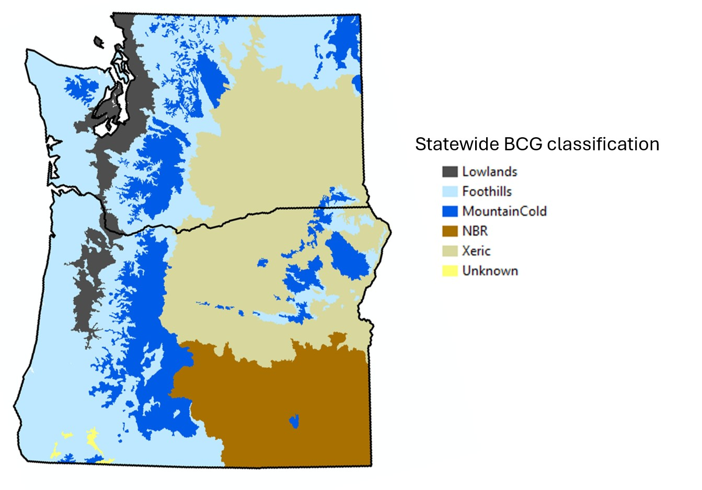

```{r setup, include=FALSE}
knitr::opts_chunk$set(echo = FALSE
                      , results = 'asis'
                      , warning = FALSE
                      , message = FALSE)
```

The tools were calibrated for small to mid-order freshwater wadeable streams in
Oregon and Washington. The MaritimeNW BCG and BioDiversity Index were calibrated
for the Pacific Maritime Region (western ecoregions only, minus the Klamath). 
The rest provide statewide coverage. The map below shows the study area overlaid
with the statewide BCG classification scheme.

```{r, echo=FALSE, out.width="50%", fig.cap="Figure 1. Statewide BCG classification of Oregon and Washington."}

```

---

*Last updated 2026-10-30*
